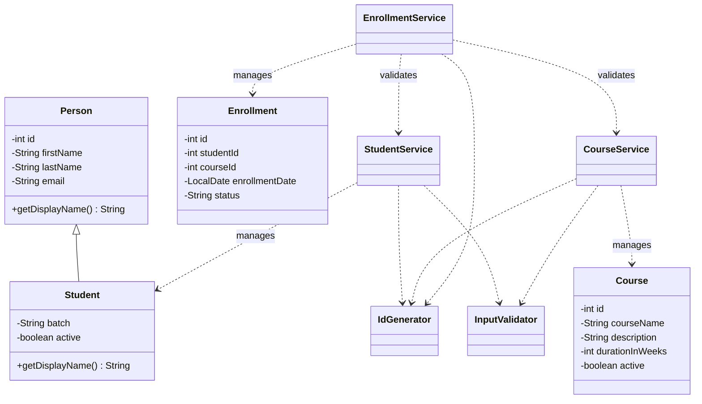

# LearnTrack – Student & Course Management System

## Project Overview

LearnTrack is a console-based Student and Course Management System developed using Core Java.

The application allows administrators to manage students, courses, and student enrollments through an interactive menu-driven interface.

The project demonstrates fundamental Java programming concepts, object-oriented programming, collections, exception handling, and modular application design.

## Features

### Student Management
- Add new students
- View all students
- Search students by ID
- Update student information
- Deactivate students

### Course Management
- Add new courses
- View all courses
- Search courses by ID
- Update course information
- Deactivate courses

### Enrollment Management
- Enroll students into courses
- View all enrollments
- Search enrollments by ID
- View enrollments by student
- Cancel enrollments
- Prevent duplicate active enrollments
- Validate student and course availability

## Technologies Used

- Java 21
- Maven
- IntelliJ IDEA
- ArrayList
- Java Collections Framework
- Java Exception Handling
- LocalDate

## Project Structure
```
src/
└── main/
    └── java/
        └── com/
            └── airtribe/
                └── learntrack/
                    ├── entity/
                    │   ├── Person.java
                    │   ├── Student.java
                    │   ├── Course.java
                    │   └── Enrollment.java
                    │
                    ├── service/
                    │   ├── StudentService.java
                    │   ├── CourseService.java
                    │   └── EnrollmentService.java
                    │
                    ├── ui/
                    │   └── Main.java
                    │
                    ├── exception/
                    │   ├── EntityNotFoundException.java
                    │   └── InvalidInputException.java
                    │
                    └── util/
                        ├── IdGenerator.java
                        └── InputValidator.java

docs/
    ├── Setup_Instructions.md
    ├── JVM_Basics.md
    └── Design_Notes.md
```

## Object-Oriented Programming Concepts

The project demonstrates:

1. Encapsulation – private fields with getters and setters.
2. Inheritance – Student extends Person.
3. Polymorphism – Student overrides getDisplayName().
4. Constructors – object initialization and constructor overloading.
5. Static members – ID generation using static counters.
6. Abstraction of responsibilities – business logic is separated into service classes.

## Application Architecture

The application follows a simple layered structure:

- UI Layer: Handles console input, menus, and output.
- Service Layer: Contains application business logic.
- Entity Layer: Represents students, courses, and enrollments.
- Utility Layer: Provides ID generation and input validation.
- Exception Layer: Handles application-specific errors.

## Data Storage

The application currently uses ArrayList for in-memory data storage.

No external database is required. Data is cleared when the application terminates.

## How to Run

1. Install JDK 21.
2. Open the project in IntelliJ IDEA.
3. Configure the project SDK to JDK 21.
4. Reload the Maven project.
5. Run the Main.java class.

## Future Improvements

- Database integration
- Persistent data storage
- Email format validation
- More advanced search and filtering
- Unit testing with JUnit


## Class Diagram




## Author

Developed as a Core Java learning project.
